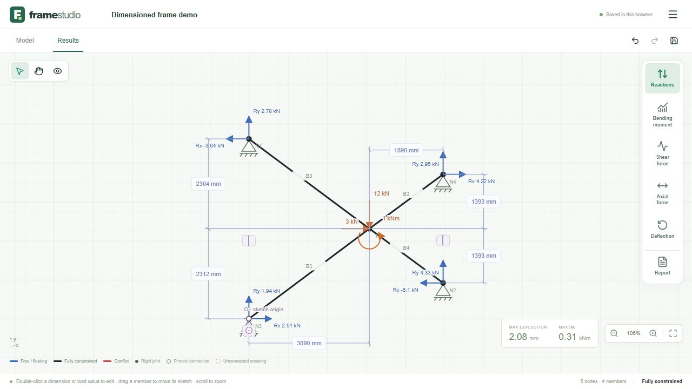

# Frame Studio

## [Open Frame Studio in your browser →](https://achiee7.github.io/frame-studio/)

**No installation or account is needed.** Open the link above, draw your frame, and view the calculated forces in Results. Use the save icon to keep a named project in your browser.

An open-source, browser-based editor and calculator for 2D structural frames. Draw beams and struts, add supports and loads anywhere on a member, constrain and dimension the sketch, then inspect reactions, axial forces, shear, bending moments and deflections.

Projects, recovery drafts and named beam presets stay in your browser. There is no account, collaboration service, database, API key, analytics or backend. No project data is sent to a server. This edition is independent of the separately hosted collaborative app.



## Sections and easier modelling

- Browse HEA, HEB, IPE and hollow sections in a category tree with profile previews, dimensioned drawings and property details.
- Star favourite sections, or create named custom profiles from a standard shape and edit all dimensions. Favourites, saved sections and CAD mass properties stay in your browser and travel with backups.
- Member settings put end releases and continuity first, followed by a foldable section preview.
- Box-select geometry, use Shift to extend a selection, and navigate the optional hierarchical model tree.
- Press Enter to finish drawing; Escape cancels the preview. Member lengths appear on the canvas.
- Apply point or distributed forces normal to a beam, following its angle. Deflection diagrams show actual displacement values in the selected units. Hover the section name for read-only properties.

See [section data, calculation conventions and controls](docs/sections.md) for details.

## Save projects

Use the save icon next to undo/redo. Open **Menu → Projects** to reopen a project, save a copy, archive/restore projects, or import/export JSON. A recovery draft is saved automatically and survives refresh. Named sections and CAD mass inertia values are kept in the local beam library.

**Back up saved projects & beams** exports all named projects (including archived ones) and named beam presets. Save the current draft first, or export it separately. Importing a backup merges it with existing browser data; conflicting IDs are copied to new IDs instead of overwriting an existing project.

Browser storage uses `localStorage`, not cookies. It can hold full frame models without sending them with web requests. It belongs to the current browser profile and website origin; another device, private browsing, a changed domain, or clearing browser/site data does not retain the same library. Keep JSON backups of important work. The app reports storage failures rather than claiming a failed save succeeded.

Exported single-frame JSON uses the same `frame-studio-v1` format as the collaborative edition. To move a frame from there, export its JSON and import it here. Nothing is imported automatically from the shared service.

## Modelling and analysis

- The solver stores geometry in m, forces in kN and stiffness in kN/m². Settings independently select metric or imperial dimensions, forces, moments, stress/yield, deflection and distributed-load length units. Changing display units preserves the physical model. Numbers use a decimal comma and dot thousands separator (12.345,67); enter decimals with a comma.
- Rigid joints share translation and rotation. Crossing pins share translation while preserving separate rotations for different continuous member families. An internal hinge releases all attached member ends. Individual end releases override joint continuity.
- Crossings remain disconnected until joined. Geometric collinearity does not itself make two segments one physical beam. Dimension constraints affect the undeformed sketch, not the structural stiffness equations.
- Loads at member ends stay attached to the corresponding node. Interior loads can keep an explicit distance from a member end.
- Each force vector or moment can be independently marked as reversible. Impossible combined cases can be excluded before report generation. Reports use only included cases, a common bending-diagram scale, equilibrium residuals and a final complete node-results table.

Results offers both linear elastic analysis and **Material · loading & unloading**. Material mode uses small-displacement distributed-fibre Euler–Bernoulli elements with bilinear kinematic hardening, incremental loading and an unloading path to zero force. Green indicates elastic response, orange plastic history with calculated permanent set, and red an entered tensile/strain limit or an ideal perfectly plastic mechanism. Gray means unresolved, not proven failure. Material mode supports 20 members and requires a section shape; elastic analysis supports 80 members and A/I-only sections.

S235JR is the default. The material library has 20 starting presets across structural steels, stainless grades, aluminium alloys and engineering plastics. Yield/proof strength, modulus, post-yield tangent and optional tensile/strain limits are editable. Catalog hardening is an assumed 1% of E, not a certified curve. Some presets deliberately have no failure limit. Product form, thickness, environment and stress–strain data require verification; plastics use a short-term symmetric approximation without creep or temperature effects.

**Worked reports** render LaTeX equations with actual numerical substitutions. The elastic reversal report includes geometry, element stiffness, transformations, supports, a solved matrix row, end actions, reactions and equilibrium checks for every included case. Results → result options → **Download worked calculation report** exports the current material run, a single-fibre plastic correction, the converged loading/unloading path, residual deformation and limit criteria. Both reports embed unrounded audit JSON, math styles and fonts and can be printed or saved as PDF without an external CDN. Elastic reversals are independent elastic runs, not a nonlinear plastic-history envelope.

Neither mode checks buckling, second-order response, connection failure, shear failure, creep, fatigue, dynamics or design-code compliance. Material failure limits are not an all-modes safety verdict; no post-rupture deformation is predicted. Mass moments of inertia are reference data, not area inertia for static bending. Verify the model and analysis independently before engineering design use. See [material and report methodology](docs/material-analysis.md).

<details>
<summary><strong>For developers: local setup, self-hosting and tests</strong></summary>

The instructions in this section are only for people changing the source code or hosting their own copy. To use the calculator, open [the live website](https://achiee7.github.io/frame-studio/); no setup is required.

### Run locally

Install Node.js 22.18 or newer (Node 24 is used in CI), then:

```sh
npm ci
npm run dev
```

Open the local URL printed by Vite. To verify the production build:

```sh
npm test
npm run build
npm run preview
```

The `dist/` directory is the complete static website. Serve it over HTTP or HTTPS; opening `index.html` as a `file://` URL is not supported. The app makes no external font requests. Once loaded, calculations and storage run locally; this is not an installable offline PWA.

### Publish your own copy on GitHub Pages

1. Create your own GitHub repository and upload this folder's contents, including `.github/workflows/pages.yml` and `package-lock.json`. Do not upload `node_modules/` or `dist/`.
2. Push to the `main` branch.
3. In **Settings → Pages → Build and deployment**, choose **GitHub Actions**. Rerun the workflow if the initial run occurred before Pages was enabled.
4. The included workflow tests, builds and publishes `dist/`. Its deployment URL appears in the Actions run and repository Pages settings.

Vite uses relative asset paths (`base: './'`), so the same build works at a repository subpath such as `/frame-studio/` or at a custom-domain root. If your default branch is not `main`, update the workflow's branch filter.

Other static hosts can also serve `dist/`. `vite preview` is only a local preview server, not a production hosting service. The workflow follows the [Vite deployment guide](https://vite.dev/guide/static-deploy.html).

### Tests and source layout

`npm test` runs analytical beam/truss benchmarks, an independent Python-derived four-arm reference, equilibrium checks, CAD dimensions and constraints, rigid/floating sketch behaviour, load placement, reversals, reports and browser-storage failure/backup tests, analytical plastic bar/bending and unloading benchmarks, failure load factors, independent unit conversions and worked-report trace checks.

- `app/solver.ts`, `app/plastic.ts`: elastic and material finite element analysis.
- `app/model.ts`, `app/cad.ts`: model validation and sketch constraints.
- `app/studio.tsx`: editor interface.
- `app/local-storage.ts`: browser project, recovery and preset storage.
- `app/frame-report.ts`, `app/material-report.ts`, `app/report-calculations.ts`: printable worked reports.
- `app/units.ts`, `app/materials.ts`: display conversions and sourced material presets.
- `scripts/build-math-assets.mjs`: regenerate embedded KaTeX CSS/fonts after updating KaTeX.
- `scripts/`: tests, independent reference and source-release packager.

The UI and solver were independently implemented. No source code or private assets from the original FrameDesign website are included. Only authored application files and sanitized numerical test fixtures were retained from the collaborative edition; authentication, deployment identifiers, credentials and stored shared projects are excluded.

</details>

## License

Copyright © 2026 Frame Studio contributors. Application code is licensed under **GPL-3.0-only**; see [LICENSE](LICENSE). This program comes without warranty. Dependencies retain their respective licenses.

Every production build includes `LICENSE.txt`, dependency notices, and a matching `frame-studio-source.zip`. **Menu → About & license** exposes those files. Keep these files and the corresponding source available when redistributing the built website. The source archive is generated automatically from this checkout during `npm run build`; generated archives, dependencies and build output are excluded from the archive itself.
